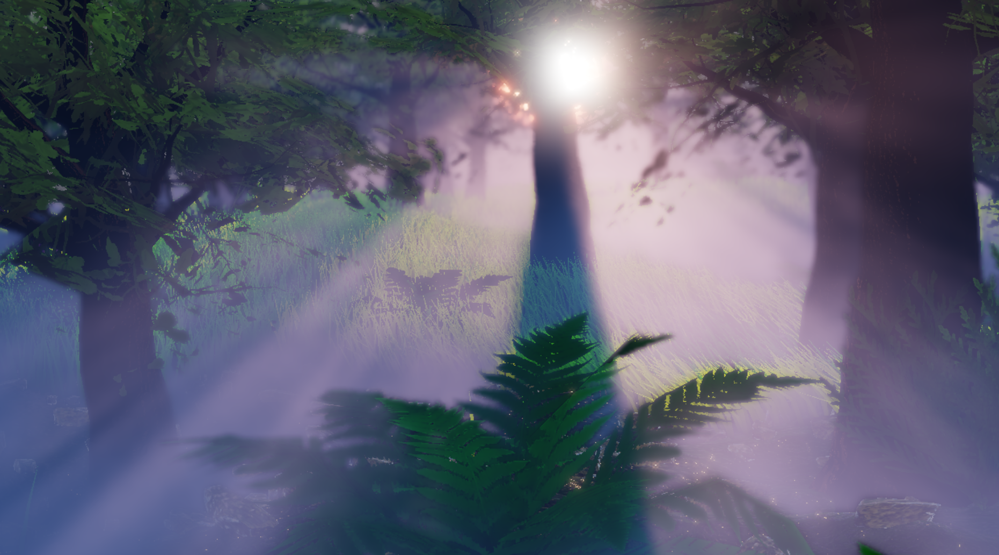

<div align="center">

# FromSoheWare Engine

**DirectX 12 と C++ で構築された、自然環境表現とパフォーマンスを追求する自作ゲームエンジン**

[](https://github.com/so1218/FROM-SOHEWARE/actions/workflows/DebugBuild.yml)
[](https://github.com/so1218/FROM-SOHEWARE/actions/workflows/DevelopmentBuild.yml)
[](https://github.com/so1218/FROM-SOHEWARE/actions/workflows/ReleaseBuild.yml)

<br />



</div>

---

## 目次 
1. [概要](#1-概要)
2. [主な技術的強み](#2-主な技術的強み)
3. [開発ドキュメント (マニュアル)](#3-開発ドキュメント-マニュアル)
4. [ディレクトリ構成](#4-ディレクトリ構成)
5. [開発に使用した技術・ツール一覧](#5-開発に使用した技術--ツール一覧)
6. [ビルド構成 & 動作環境](#6-ビルド構成--動作環境)
7. [使用アセット & 参考資料](#7-使用アセット--参考資料)

---

## 1. 概要

**FromSoheWare**は、AAA タイトルのような美しい自然環境や広大な世界観の表現を目指して個人開発している C++ / DirectX 12 のゲームエンジンです。

ボリュメトリックフォグをはじめとする表現技術と、効率的なインゲームパラメータ調整ツールを統合しています。

---

## 2. 主な技術的強み

### 2.1. ボリュメトリックフォグ (Volumetric Fog)
- **視錐台ボクセル（Froxel）サンプリング**: 視錐台を 160×90×64 のボクセルに分割し、奥行きは指数で割り振る。画面のピクセルごとではなくボクセルごとに光と濃さを計算するため、高精度な霧表現を低負荷で実現。
- **時間方向の蓄積とノイズ除去**: 前フレームの結果と混ぜ (テンポラル再投影)、隣のボクセルとならすことで、少ないサンプル数でもちらつかない霧にしている。
- **ライトシャフト**: Directional / Point / Spot Light から漏れ出る光の筋（ライトシャフト）をリアルタイム計算。
- **ボリュームフォグ**: 空間全体のフォグに加え、Box 型および Sphere 型のローカルフォグ配置に対応。エディタで置くだけでなく、ゲーム中に毎フレーム生成・移動・削除できる。
- **3D ノイズ連携**: 単純な距離フォグではなく、ノイズテクスチャによる空気の揺らぎや密度の濃淡を表現。
- **時間帯と天候による変化**: 晴れの霧を昼と夜で別に持ち、朝夕に滑らかに切り替える。雨・雷雨は天候ごとの霧へ移り変わる。

### 2.2. GPU で計算する草の延焼
- **コンピュートシェーダーによる燃え広がり**: 草原を覆う 1024×1024 の燃え具合の地図を毎フレーム GPU で進める。各マスが隣の炎から熱を受けて燃え移る仕組みで、風下ほど燃え広がりやすく、雨で地面が濡れているほど燃え広がる距離が短くなる。草の生えていない所で火は止まる。
- **見た目への反映**: 草は燃えるにつれて枯れ、先端から炭になって縮む。地面は焦げて黒くなる。
- **ゲームロジックとの連携**: 地図を 256×256 に縮めて CPU へ読み戻し (炎の強さは最大値、燃え跡は平均値で縮める)、燃えている所でのダメージ、焼けた草むらに隠れられない判定、炎や煙のパーティクル・音・ライトの配置に使う。

### 2.3. 実ゲームを見据えたパフォーマンス最適化 (60 FPS 維持)
- **カリング処理**: 視錐台カリングおよび距離カリングにより、遠景の草木や 3D モデルの不要な GPU 描画を自動カット。
- **PIX プロファイリング & パスマーカー**: `WinPixEventRuntime` を統合し、描画パスごとのプロファイリングと可視化を実施。多数のパスを通しながらも **GPU 時間約 8ms（60 FPS 安定）** を達成。

### 2.4. データ保存と UI 化を一括で行う `PropertyBinder`
- **わずか 2 行でのデータバインド**: 変数登録と描画呼び出しの最小コードで、JSON への自動保存/読み込みと Dear ImGui でのデバッグ UI 表示を同期。
- **マルチマテリアルリアルタイム調整**: モデル単位・マテリアル単位でカラー、法線マップ、粗さ、リムライト等のパラメータを画面上で即座に調整可能。
- **ステージごとの設定**: 保存先をフォルダで分けられ (`Stages/Stage1/Ground` など)、地形・草木・天候・時間・ポストエフェクトをステージごとに持てる。ステージを切り替えるとシーンを作り直し、その設定で読み込み直す。

### 2.5. カスタムパーティクルシステム & インゲームエディタ
- **モジュール構造**: Unity のパーティクルシステムを参考に設計。エミッターを作成・追加し、インゲームのパーティクルエディタ上でパラメータを調整しながら各種エフェクトを制作可能。

### 2.6. その他のグラフィックス & 環境表現機能
- **PBR (物理ベースレンダリング)**: 金属度 (Metalness)・粗さ (Roughness) に基づくリアルな材質表現。
- **地形 & 植生システム**: 地形描画および草木の大量描画 (木は最大 8000)。歩ける地形の外には、影を落とさない遠景の地形を描き、質感と模様の位置をそろえてつなぐ。
- **カスケードシャドウ**: 影を落とす距離をカメラの描画距離と分け (初期値 300m)、その範囲を手前ほど細かく割り振る。距離の端では影をだんだん消し、切れ目を見せない。
- **動的天候・時間変化**: 太陽位置・天空カラーのグラデーション・雷などの天候・時間推移の連動。
- **夜空の星**: 空を立方体の 6 面のマス目に分け、マスごとの乱数で星の位置・明るさ・色を決めて手続き的に生成。星ごとにずらして瞬き、空と一緒に回る。
- **ポストエフェクト**: ブルーム、トーンマッピング、被写界深度、SSAO、ビネット等の表現。ゲームの状態 (隠れている・燃えているなど) を伝える画面の縁の色を、保存する設定とは別に毎フレーム重ねられる。
- **SDF フォントによる文字描画**: TrueType フォントから距離場 (SDF) の文字アトラスを作り、大きさを変えても輪郭がぼけない。縁取り・影・縦書きに対応。
- **3D サウンド**: XAudio2 / X3DAudio による距離減衰と定位。ループ音の音量を後から変えられる。

---

## 3. 開発ドキュメント (マニュアル)

FromSoheWare エンジンでゲームを作るためのドキュメントです。目次は [project/Engine/Docs/index.md](project/Engine/Docs/index.md) です。

| 目的 | 読むところ |
| :--- | :--- |
| まず動かしたい | [はじめに](project/Engine/Docs/start/index.md) |
| ゲームの作り方を一通り知りたい | [チュートリアル: ジェム集めゲームを作る](project/Engine/Docs/tutorial/index.md) |
| やりたいことのやり方を知りたい | [機能別ガイド](project/Engine/Docs/guides/index.md) |
| 仕組みを知りたい・エンジンを改造したい | [エンジンの仕組み](project/Engine/Docs/concepts/index.md) |
| 関数を調べたい | [早見表](project/Engine/Docs/reference/cheatsheet.md) / [API リファレンス](project/Engine/Docs/reference/api.md) |

---

## 4. ディレクトリ構成

プロジェクトの主要なファイル構造は以下の通りです。

```text
FromSoheWare/
├── .github/          # GitHub Actions のワークフロー定義
├── generated/        # 自動生成ファイル
├── project/          # プロジェクト本体 (ソースコードおよびアセット)
│   ├── Assets/       # ゲームの3Dモデル, テクスチャ, 音などのアセット群
│   ├── Engine/       # エンジンのコアシステム (git subtree で取り込む)
│   │   ├── Core/ Graphics/ Framework/ Audio/ など  # エンジンのソース
│   │   ├── Shaders/      # シェーダー(HLSL)
│   │   ├── Assets/       # エンジンが使うテクスチャ, モデル, フォント, PSO 定義
│   │   ├── Docs/         # 開発ドキュメント (Sphinx)
│   │   ├── Template/     # 新しいゲームのひな形
│   │   ├── CHANGELOG.md  # エンジンの版ごとの変更点
│   │   └── externals/    # ImGui, DirectXTex などの外部ライブラリ
│   ├── Game/         # ゲーム側のアプリケーション層 (シーン, プレイヤー, 敵, UI など)
│   ├── packages/     # WinPixEventRuntime (PIXプロファイリング用 NuGet パッケージ)
│   ├── Cache/        # キャッシュファイル
│   ├── Dumps/        # クラッシュダンプ
│   └── logs/         # 実行ログ
├── .editorconfig     # コーディングスタイル設定
├── .gitignore        # Gitの管理除外設定
└── README.md         # 本ドキュメント
```

---

## 5. 開発に使用した技術 & ツール一覧

| カテゴリ | 内容 / 使用ツール |
| :--- | :--- |
| **使用言語** | C++20 |
| **グラフィックス API** | DirectX 12 / HLSL |
| **プロファイリング・デバッグ** | ImGui, PIX for Windows (`WinPixEventRuntime`) |
| **サウンド** | XAudio2 / X3DAudio |
| **外部ライブラリ** | ImGui, ImGuizmo, DirectXTex, Assimp, nlohmann_json, FastNoiseLite, stb_truetype / stb_rect_pack (ImGui 同梱) |
| **アセット制作・編集** | Blender, Mixamo, EffectTextureMaker |
| **自動ビルド (CI)** | GitHub Actions (Debug / Development / Release のビルドと、ドキュメントのビルド) |

---

## 6. ビルド構成 & 動作環境

### ビルド構成

| 構成 | 特徴と使いどころ |
| :--- | :--- |
| **Debug** | **エンジンコア開発・グラフィックス検証用**<br>最適化をオフにし、DirectX 12 のデバッグレイヤーを有効化。API のエラーやメモリリーク、描画パイプラインの警告を詳細にチェック。 |
| **Development** | **ゲーム制作・機能テスト用**<br>適切な最適化を行い軽量動作を維持しつつ、インゲームエディタや ImGui、検証用テストシーンが使用可能。普段のゲーム開発に最適。 |
| **Release** | **最終チェック・配布用**<br>デバッグ用 UI やログ機能をオフにし、最高速度で実行。 |

### 動作環境

| 項目 | 条件 |
| :--- | :--- |
| **OS** | Windows 10 または Windows 11 |
| **開発ツール** | Visual Studio 2026 (プラットフォームツールセット v145) |
| **グラフィック** | DirectX 12 に対応した GPU |

---

## 7. 使用アセット & 参考資料

### 使用アセット
本エンジンのデモ・検証シーン作成において、以下の素材およびツールを活用させていただいています。
- **3D モデル / アニメーション**: [Sketchfab](https://sketchfab.com/), [Mixamo](https://www.mixamo.com/)
- **テクスチャ / 環境マップ (HDRI)**: [Poly Haven](https://polyhaven.com/)
- **フォント**: Noto Sans JP, Shippori Mincho, Zen Kaku Gothic New, Cinzel ([Google Fonts](https://fonts.google.com/), SIL Open Font License)
- **エフェクトテクスチャ作成**: EffectTextureMaker

### 参考資料
- **レンダリング技術・ポストエフェクト**
  - SIGGRAPH / GDC 講演論文
  - NVIDIA Developer Graphics Articles
  - Zenn (技術コミュニティ記事)
- **エンジン設計・アーキテクチャ**
  - **Unity**: モジュール型パーティクルシステムの設計思想
  - **Unreal Engine**: Property Binding およびマテリアルパラメータ調整構造