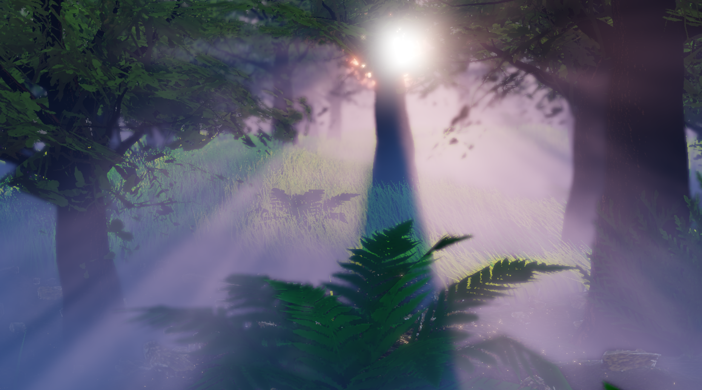

<div align="center">

# FromSoheWare Engine

**DirectX 12 と C++ で構築された、自然環境表現とパフォーマンスを追求する自作ゲームエンジン**

[](https://github.com/so1218/FROM-SOHEWARE/actions/workflows/DebugBuild.yml)
[](https://github.com/so1218/FROM-SOHEWARE/actions/workflows/DevelopmentBuild.yml)
[](https://github.com/so1218/FROM-SOHEWARE/actions/workflows/ReleaseBuild.yml)

<br />



</div>

---

## 目次 
1. [概要](#1-概要)
2. [主な技術的強み](#2-主な技術的強み)
3. [開発ドキュメント (マニュアル)](#3-開発ドキュメント-マニュアル)
4. [ディレクトリ構成](#4-ディレクトリ構成)
5. [開発に使用した技術・ツール一覧](#5-開発に使用した技術--ツール一覧)
6. [ビルド構成 & 動作環境](#6-ビルド構成--動作環境)
7. [使用アセット & 参考資料](#7-使用アセット--参考資料)

---

## 1. 概要

**FromSoheWare**は、AAA タイトルのような美しい自然環境や広大な世界観の表現を目指して個人開発している C++ / DirectX 12 のゲームエンジンです。

ボリュメトリックフォグをはじめとする表現技術と、効率的なインゲームパラメータ調整ツールを統合しています。

---

## 2. 主な技術的強み

### 2.1. ボリュメトリックフォグ (Volumetric Fog)
- **視錐台ボクセル（Froxel）サンプリング**: 視錐台をボクセル状に分割して計算量を大幅に削減し、高精度な霧表現を低負荷で実現。
- **ライトシャフト**: Directional / Point / Spot Light から漏れ出る光の筋（ライトシャフト）をリアルタイム計算。
- **ボリュームフォグ**: 空間全体のフォグに加え、Box 型および Sphere 型のローカルフォグ配置に対応。
- **3D ノイズ連携**: 単純な距離フォグではなく、ノイズテクスチャによる空気の揺らぎや密度の濃淡を表現。

### 2.2. 実ゲームを見据えたパフォーマンス最適化 (60 FPS 維持)
- **カリング処理**: 視錐台カリングおよび距離カリングにより、遠景の草木や 3D モデルの不要な GPU 描画を自動カット。
- **PIX プロファイリング & パスマーカー**: `WinPixEventRuntime` を統合し、描画パスごとのプロファイリングと可視化を実施。多数のパスを通しながらも **GPU 時間約 8ms（60 FPS 安定）** を達成。

### 2.3. データ保存と UI 化を一括で行う `PropertyBinder`
- **わずか 2 行でのデータバインド**: 変数登録と描画呼び出しの最小コードで、JSON への自動保存/読み込みと Dear ImGui でのデバッグ UI 表示を同期。
- **マルチマテリアルリアルタイム調整**: モデル単位・マテリアル単位でカラー、法線マップ、粗さ、リムライト等のパラメータを画面上で即座に調整可能。

### 2.4. カスタムパーティクルシステム & インゲームエディタ
- **モジュール構造**: Unity のパーティクルシステムを参考に設計。エミッターを作成・追加し、インゲームのパーティクルエディタ上でパラメータを調整しながら各種エフェクトを制作可能。

### 2.5. その他のグラフィックス & 環境表現機能
- **PBR (物理ベースレンダリング)**: 金属度 (Metalness)・粗さ (Roughness) に基づくリアルな材質表現。
- **地形 & 植生システム**: 地形描画および草木の大量描画。
- **動的天候・時間変化**: 太陽位置・天空カラーのグラデーション・雷などの天候・時間推移の連動。
- **ポストエフェクト**: ブルーム、トーンマッピング、被写界深度等の表現。

---

## 3. 開発ドキュメント (マニュアル)

FromSoheWareエンジンを使ったゲーム開発のマニュアルです。
開発を始める際は、まず以下の目次ページをご確認ください。

### [開発ドキュメント目次 (docs/index.md)](docs/index.md)

**【主な収録ガイド】**
- **[1. シーンとライフサイクル](docs/sceneGuide.md)**
  - シーンの作成 / オブジェクトの自動ライフサイクル / `Game` クラスへのシーン登録
- **[2. オブジェクトの作成と制御](docs/gameObjectGuide.md)**
  - `GameObject` の基本仕様 / キャラクター実装例 / 衝突判定
- **[3. 描画](docs/drawingGuide.md)**
  - `Model`, `AnimationModel` の再生など
- **[4. デバッグとパラメータ調整](docs/propertyBinderGuide.md)**
  - `PropertyBinder` と ImGui の自動連携 / パラメータの保存とロード

---

## 4. ディレクトリ構成

プロジェクトの主要なファイル構造は以下の通りです。

```text
FromSoheWare/
├── .github/          # GitHub Actions のワークフロー定義
├── docs/             # 開発ドキュメント・ガイドライン
├── generated/        # 自動生成ファイル
├── project/          # プロジェクト本体 (ソースコードおよびアセット)
│   ├── Assets/       # 3Dモデル, テクスチャ, シェーダー(HLSL) などのアセット群
│   ├── Engine/       # エンジンのコアシステム
│   ├── Game/         # ゲーム側のアプリケーション層
│   ├── externals/    # ImGui, DirectXTex などの外部ライブラリ
│   ├── packages/     # WinPixEventRuntime (PIXプロファイリング用 NuGet パッケージ)
│   ├── Cache/        # キャッシュファイル
│   ├── Dumps/        # クラッシュダンプ
│   └── logs/         # 実行ログ
├── .editorconfig     # コーディングスタイル設定
├── .gitignore        # Gitの管理除外設定
└── README.md         # 本ドキュメント
```

---

## 5. 開発に使用した技術 & ツール一覧

| カテゴリ | 内容 / 使用ツール |
| :--- | :--- |
| **使用言語** | C++ |
| **グラフィックス API** | DirectX 12 / HLSL |
| **プロファイリング・デバッグ** | ImGui, PIX for Windows (`WinPixEventRuntime`) |
| **外部ライブラリ** | ImGui, ImGuizmo, DirectXTex, Assimp, nlohmann_json, FastNoiseLite |
| **アセット制作・編集** | Blender, Mixamo, EffectTextureMaker |
| **自動テスト** | GitHub Actions |

---

## 6. ビルド構成 & 動作環境

### ビルド構成

| 構成 | 特徴と使いどころ |
| :--- | :--- |
| **Debug** | **エンジンコア開発・グラフィックス検証用**<br>最適化をオフにし、DirectX 12 のデバッグレイヤーを有効化。API のエラーやメモリリーク、描画パイプラインの警告を詳細にチェック。 |
| **Development** | **ゲーム制作・機能テスト用**<br>適切な最適化を行い軽量動作を維持しつつ、インゲームエディタや ImGui、検証用テストシーンが使用可能。普段のゲーム開発に最適。 |
| **Release** | **最終チェック・配布用**<br>デバッグ用 UI やログ機能をオフにし、最高速度で実行。 |

### 動作環境

| 項目 | 条件 |
| :--- | :--- |
| **OS** | Windows 10 または Windows 11 |
| **開発ツール** | Visual Studio 2022 |
| **グラフィック** | DirectX 12 に対応した GPU |

---

## 7. 使用アセット & 参考資料

### 使用アセット
本エンジンのデモ・検証シーン作成において、以下の素材およびツールを活用させていただいています。
- **3D モデル / アニメーション**: [Sketchfab](https://sketchfab.com/), [Mixamo](https://www.mixamo.com/)
- **テクスチャ / 環境マップ (HDRI)**: [Poly Haven](https://polyhaven.com/)
- **エフェクトテクスチャ作成**: EffectTextureMaker

### 参考資料
- **レンダリング技術・ポストエフェクト**
  - SIGGRAPH / GDC 講演論文
  - NVIDIA Developer Graphics Articles
  - Zenn (技術コミュニティ記事)
- **エンジン設計・アーキテクチャ**
  - **Unity**: モジュール型パーティクルシステムの設計思想
  - **Unreal Engine**: Property Binding およびマテリアルパラメータ調整構造