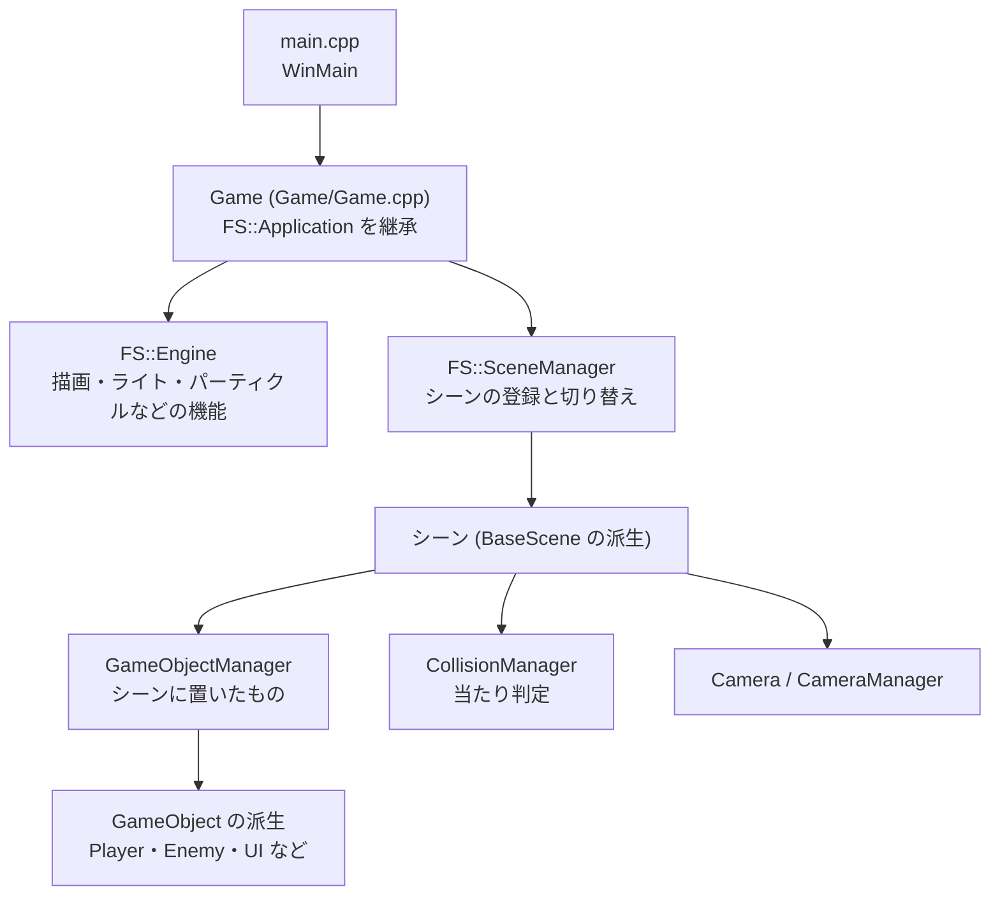
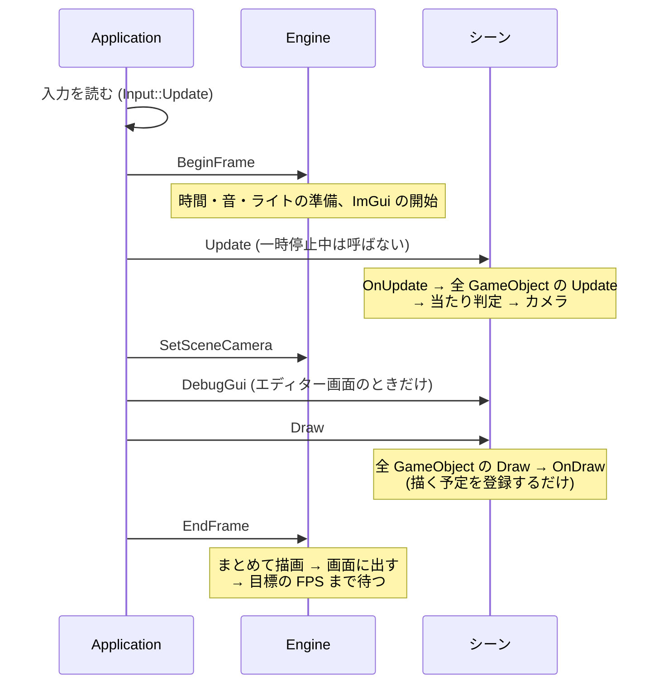

# 全体の構成と 1 フレームの流れ

## 全体の構成



- `Engine/` はどのゲームでも使う機能、`Game/` はこのゲームだけのコードです。`Engine/` から `Game/` のものを使ってはいけません
- メインループと 1 フレームの処理の順番は、エンジンの `FS::Application` が受け持ちます。ゲームは `Application` を継承した `Game` で、ウィンドウの設定とシーンの登録だけを書きます
- シーンごとに、GameObject・当たり判定・カメラが分かれています

## 1 フレームの流れ



押さえておくことは 3 つです。

- **`Draw()` は描く予定の登録です。** `Model::Draw()` などはその場では描かず、`EndFrame()` でまとめて描きます。だから `Draw()` を呼ぶ順番は描画結果に関係しません (UI の重なりは `SetLayerOrder` で決めます)
- **当たり判定は全オブジェクトの `Update()` のあとです。** `Update()` で動いた結果で判定し、その結果を受けてカメラが動きます
- **点光源とスポットライトは毎フレーム登録します。** `BeginFrame()` で全部消えるので、光らせる間は毎フレーム `SubmitPointLight` などを呼びます

## `Engine*` を渡す理由

モデルや PropertyBinder を作るとき、コンストラクタに `Engine*` を渡します。

```cpp
model_ = std::make_unique<Model>(engine_, "tree");
```

描画・ライト・パーティクルなどの機能は、どこからでも呼べるグローバルな変数にせず、`Engine` が持っています。
何を使っているかが引数に出るので、コードを読む人に依存関係が分かり、エンジンを作り直したときに古いポインタを使い続ける事故も起きにくくなります。

`Engine*` は、シーン → GameObject → その中の部品 (武器・UI など) の順に、コンストラクタで受け渡していきます。

```cpp
// シーン
objectManager_.Create<Player>(engine_);

// Player
Player::Player(Engine* engine) : engine_(engine)
{
    weapon_ = std::make_unique<PlayerWeapon>(engine_);
}
```

## どこからでも使える機能

プロセスの中に 1 つあればよく、どこからでも使うものは、シングルトン (`GetInstance()`) として用意しています。

| 機能 | 使い方 |
| :--- | :--- |
| 入力 | `Input::GetInstance()` (ゲームの操作は `GameInput` を使う) |
| 時間 | `TimeManager::GetInstance()->GetDeltaTime()` |
| 音 | `AudioPlayer::GetInstance()` |
| 時間帯と天気 | `EnvironmentManager::GetInstance()` |
| ログ | `LOG_INFO(...)` などのマクロ |
| 開発用のエラー | `DevError::Report(...)` |
| デバッグ描画 | `DebugDraw::DrawLine(...)` など |

`GetInstance()` が参照を返すもの (`Input`、`AudioPlayer`) は `.`、ポインタを返すもの (`TimeManager`、`EnvironmentManager`) は `->` で使います。

## ビルド構成ごとの違い

ビルド構成ごとに、次のマクロが定義されています。開発用の機能はこのマクロで有効・無効が切り替わります。

| マクロ | Debug | Development | Release | 有効になるもの |
| :--- | :---: | :---: | :---: | :--- |
| `_DEBUG` | ✓ | | | DirectX 12 のデバッグレイヤー、終了時の解放漏れの報告、`assert` |
| `ENABLE_DEV_TOOLS` | ✓ | ✓ | | シェーダーの実行時コンパイル、開発用のエラー表示、`LOG_INFO` / `LOG_WARN`、PIX のマーカー |
| `ENABLE_IMGUI` | ✓ | ✓ | ✓ | エディター画面、PropertyBinder の編集 |
| `ENABLE_DEBUG_DRAW` | ✓ | ✓ | ✓ | `DebugDraw`、コライダーやライトの表示 |
| `ENABLE_DEBUG_CAMERA` | ✓ | ✓ | ✓ | デバッグカメラ (Y キー) |

`assert` は Debug でしか動きません。Development でも気づいてほしい間違いは、`DevError::Report` で知らせます。
