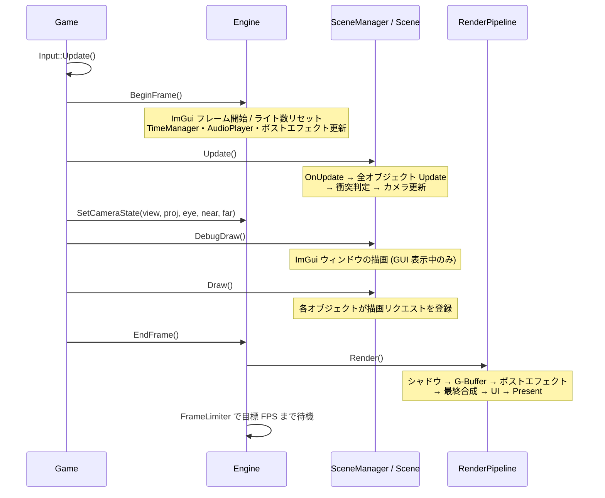

# FromSoheWare Engine 基本設計ガイド

本ドキュメントでは、FromSoheWare エンジン全体のアーキテクチャ、基本設計思想、および実装時に知っておくべき共通ルールについて解説します。

---

## 目次
- [1. エンジン構造と Engine* ポインタを受け渡す流れ](#1-エンジン構造と-engine-ポインタを受け渡す流れ)
- [2. プリコンパイル済みヘッダー (pch.h) の役割とルール](#2-プリコンパイル済みヘッダー-pchh-の役割とルール)
- [3. 名前空間 (namespace FS) とヘッダーの記述ルール](#3-名前空間-namespace-fs-とヘッダーの記述ルール)
- [4. アプリケーションのライフサイクルと実行順序](#4-アプリケーションのライフサイクルと実行順序)
- [5. シングルトン機能との使い分け](#5-シングルトン機能との使い分け)
- [6. ビルド構成と機能マクロ](#6-ビルド構成と機能マクロ)

---

## 1. エンジン構造と Engine* ポインタを受け渡す流れ

FromSoheWare エンジンでは、過度なグローバル変数やシングルトン依存を避け、**「必要なコンポーネントに必要な依存関係を明示的に渡す」** 設計を採用しています。

### 1-1. なぜ Engine* を渡すのか？
描画処理、ライト管理、ポストエフェクト管理、プロパティバインダーの構築など、エンジンの基盤機能にアクセスするための起点となるのが `FS::Engine` クラスです。

生成される各オブジェクト（`BaseScene`、`GameObject`、`Player`、`Weapon` 等）は、コンストラクタ経由で `Engine*` を受け取り、内部に保持します。

```cpp
// 例：Player クラスのコンストラクタ
Player::Player(FS::Engine* engine, FS::Camera* camera)
    : engine_(engine), camera_(camera)
{
    SetTag(ObjectTag::Player);

    // Engine* を使用してコンポーネントやモデルを生成
    animationModel_ = std::make_unique<FS::AnimationModel>(engine_, "humanMesh", "humanRun");
    weapon_         = std::make_unique<FS::PlayerWeapon>(engine_);
    reticle_        = std::make_unique<FS::PlayerReticle>(engine_);

    // インゲーム調整用の PropertyBinder も Engine* を基に生成
    binder_   = std::make_unique<FS::PropertyBinder>(engine_, "Player");
    collider_ = std::make_unique<FS::Collider>(this);
}
```

### 1-2. Engine* ポインタを受け渡す流れ

`Engine*` は、以下のような順序で受け渡されていきます。

1. **Scene**
   `BaseScene` のコンストラクタで `Engine*` を受け取り、シーン内部で保持します。
2. **GameObject**
   `objectManager_.Create<T>(engine_, ...)` 経由でオブジェクトを生成する際、第1引数として `Engine*` を渡します。
3. **SubComponent**
   オブジェクトが所有する武器（`PlayerWeapon`）、UI（`PlayerReticle`）、モデル（`AnimationModel`）等も、親クラスから `Engine*` を引き継いで初期化します。

#### 実際のコード例

```cpp
// 1. シーン（PlayScene）で GameObject を生成する際、engine_ を渡す
auto player = objectManager_.Create<Player>(engine_, camera_.get());

// 2. GameObject（Player）のコンストラクタで受け取った engine を子コンポーネント群へ伝搬
Player::Player(FS::Engine* engine, FS::Camera* camera)
    : engine_(engine), camera_(camera)
{
    // 各サブコンポーネントの生成時に engine_ を渡す
    animationModel_ = std::make_unique<FS::AnimationModel>(engine_, "humanMesh", "humanRun");
    weapon_         = std::make_unique<FS::PlayerWeapon>(engine_);
    reticle_        = std::make_unique<FS::PlayerReticle>(engine_);
    binder_         = std::make_unique<FS::PropertyBinder>(engine_, "Player");
}
```

## 2. プリコンパイル済みヘッダー (pch.h) の役割とルール

`pch.h` には、エンジン全体で頻繁に使用する主要な外部ライブラリや標準ヘッダーが一括で定義されています。これらを事前にまとめてコンパイルしておくことで、ビルド時間を大幅に短縮しています。

---

### 2-1. pch.h に含まれている主なライブラリ

以下のライブラリ群はすべて `pch.h` 内部で一度に読み込まれています。

- **C++ 標準ライブラリ**: `<vector>`, `<memory>`, `<string>`, `<algorithm>`, `<unordered_map>`, `<format>` など多数
- **Windows API & DirectX 12**: `<Windows.h>`, `<d3d12.h>`, `<dxgi1_6.h>`, `d3dx12.h`, `DirectXMath.h` など
- **入力・音声・メディア**: DirectInput, XInput, XAudio2, Media Foundation
- **プロファイリング & デバッグ**: PIX (`pix3.h`), Dear ImGui, ImGuizmo
- **外部ライブラリ**: nlohmann/json, DirectXTex, Assimp (`Importer.hpp` 等)

---

### 2-2. 開発時の必須ルール

1. **すべての `.cpp` ファイルの 1 行目に `#include "pch.h"` を書く**  
   新規に作成した `.cpp` ファイルも含め、コードの**最上段**には必ず `#include "pch.h"` を記述してください。

2. **`pch.h` に含まれるライブラリは個別インクルード不要**
   `std::vector` や `DirectX::XMFLOAT3`、`nlohmann::json` などを使う際、各 `.cpp` ファイルで個別に `<vector>` や `<d3d12.h>` を `#include` する必要はありません（`pch.h` を通して自動的に利用可能になります）。

```cpp
// 正しい書き方（必ず1行目に pch.h を書く）
#include "pch.h"
#include "Player.h"
#include "Enemy.h"

// 誤った書き方（pch.h より上に他のヘッダーがある）
#include "Player.h"
#include "pch.h" // プリコンパイルヘッダーの仕組み上、エラーになります
```

## 3. 名前空間 (namespace FS) とヘッダーの記述ルール

FromSoheWare エンジンの基盤機能は、ゲーム固有のコードや外部ライブラリとの名前の衝突を防ぐため、すべて **`namespace FS`** の中に定義されています。

---

### 3-1. FS 名前空間の構成
エンジンのコアクラス（`Engine`, `GameObject`, `Camera`, `AnimationModel`, `Terrain`, `Collider`, `PropertyBinder` など）は `FS` 名前空間に所属しています。

```cpp
// ヘッダー内での継承や型指定の例
class Player : public FS::GameObject
{
public:
    Player(FS::Engine* engine, FS::Camera* camera);
    
private:
    FS::Engine* engine_ = nullptr;
    FS::Camera* camera_ = nullptr;
    FS::Terrain* terrain_ = nullptr;
    std::unique_ptr<FS::AnimationModel> animationModel_;
    std::unique_ptr<FS::Collider> collider_;
};
```

### 3-2. ヘッダーファイル (.h) での `using namespace` の禁止

**「ヘッダーファイル内で `using namespace FS;` や `using namespace std;` を記述してはならない」** という規約を設けています。

#### なぜ禁止なのか？（名前空間汚染の防止）
ヘッダーファイル内で `using namespace` を使うと、そのヘッダーを `#include` した**すべてのファイル**にまで対象の空間が勝手に展開されてしまいます。
その結果、意図しない場所で同名の関数や型がぶつかり、原因の特定しづらいコンパイルエラーやバグを引き起こすためです。

#### 記述ルール
- **ヘッダーファイル (`.h`)**
  型名やクラス名には必ず `FS::` や `std::` を付与して明記します。
- **実装ファイル (`.cpp`)**
  `.cpp` ファイル内に限っては、ファイル冒頭で `using namespace FS;` や `using namespace std;` を記述してコードを簡略化しても問題ありません（他のファイルへ影響を与えないため）。

```cpp
// ヘッダーファイル (.h) での NG 例
#pragma once
#include "pch.h"

using namespace FS; // このヘッダーをインクルードした全ファイルに FS が展開されてしまう

class Player : public GameObject // FS:: が省略できてしまうがスコープが汚染される
{
    ...
};
```

```cpp
// ヘッダーファイル (.h) での OK 例
#pragma once
#include "GameObject.h"

class Player : public FS::GameObject // FS:: を明記する
{
public:
    Player(FS::Engine* engine, FS::Camera* camera);

private:
    FS::Engine* engine_ = nullptr;
};
```

---

## 4. アプリケーションのライフサイクルと実行順序

アプリケーションは `main.cpp` の `WinMain` から始まり、`Game` クラスがエンジン (`FS::Engine`) とシーン管理 (`FS::SceneManager`) を所有して動かします。

```cpp
// main.cpp
int WINAPI WinMain(HINSTANCE, HINSTANCE, LPSTR, int)
{
#ifdef _DEBUG
    FS::D3DResourceLeakChecker leakCheck; // 終了時に D3D12 オブジェクトの解放漏れを報告
#endif
    Game game;   // コンストラクタでエンジンとシーンを初期化
    game.Run();  // メインループ
    return 0;
}
```

### 4-1. 起動 (Game のコンストラクタ)

1. `ProjectConfig` にウィンドウタイトル・解像度・目標 FPS を設定し、`Engine::Initialize(config)` を呼ぶ
2. `SceneManager::Initialize()` でフェード演出とシーン遷移ステートを準備
3. `RegisterScene()` で全シーンを生成して登録
4. `SetInitialScene()` で最初のシーンを決める（この時点でそのシーンの `Initialize()` が呼ばれ、フェードインが始まる）

```cpp
ProjectConfig config;
config.windowTitle = L"FROM SOHEWARE";
config.width = 1280;
config.height = 720;
config.targetFPS = 60;

engine_->Initialize(config);
```

`Engine::Initialize()` の内部では、次の順にサブシステムが初期化されます。依存関係のあるものほど後ろにあります。

| 順番 | 関数 | 主な内容 |
| :--- | :--- | :--- |
| 1 | (冒頭) | `MaterialManager`、`DebugCamera`、`FrameLimiter` の生成 |
| 2 | `InitializeSystem()` | COM の初期化、`Logger` の初期化、`GlobalVariables::LoadFiles()` による保存済みパラメータ (JSON) の読み込み |
| 3 | `InitializeWindow()` | ウィンドウの作成 |
| 4 | `InitializeInput()` | `Input` (DirectInput / XInput) と `TimeManager` の初期化 |
| 5 | `InitializeGraphics()` | (Debug 時) D3D12 デバッグレイヤー、`GraphicsDevice`、`CommandManager`、`SwapChain`、各種ディスクリプタ管理 (`SRVManager` / `DSVManager` / `RTVManager` / `OffscreenRTVManager`)、`LightManager`、`GlobalConstants` |
| 6 | `InitializeRenderer()` | `RenderContext`、`ShaderManager`、`RootSignatureManager`、`PSOManager`、`RenderPipeline` |
| 7 | `InitializeResources()` | `TextureLoader`、`RendererManager`、テクスチャ・モデル・アニメーションの一括読み込み、ボリュメトリックフォグ用 3D ノイズの生成 |
| 8 | `InitializeImGui()` | ImGui の初期化、`DebugDraw` の初期化 |
| 9 | `InitializeAudio()` | XAudio2 (`AudioDevice`) の初期化、`AudioList.csv` に書かれた音声の読み込み |
| 10 | (末尾) | `DebugGuiManager`、`ParticleSystem`、`EnvironmentManager` の初期化 |

### 4-2. メインループ (Game::Run)

ウィンドウメッセージがない間、毎フレーム次の順に処理されます。



押さえておきたいポイントは次の 3 つです。

- **`Draw()` は「描画の予約」です。** `Model::Draw()` や `Sprite::Draw()` はその場で GPU に描画するのではなく、`RendererManager` に描画リクエストを登録するだけです。実際の描画はすべて `Engine::EndFrame()` の中の `RenderPipeline::Render()` でまとめて行われます。そのため、`Draw()` を呼ぶ順番はおおむね描画結果に影響しません（2D スプライトの重なりは `SetLayerOrder()` で制御します）。
- **ライトは毎フレーム登録します。** `Engine::BeginFrame()` でポイントライト・スポットライトの数が 0 にリセットされるため、`LightManager::SubmitPointLight()` などは `Update()` または `Draw()` の中で毎フレーム呼びます。
- **ポーズ中はシーンの更新が止まります。** `TimeManager::Pause()` 中は `SceneManager::Update()` が呼ばれませんが、描画と ImGui は動き続けます。

### 4-3. デバッグカメラ

`ENABLE_DEBUG_CAMERA` が定義されているビルドでは、**Y キー** でデバッグカメラの有効/無効を切り替えられます。デバッグカメラ有効中はシーンのカメラの代わりにデバッグカメラの行列で描画され、ゲームカメラの視錐台が黄色の線で表示されます。

### 4-4. 終了

ウィンドウが閉じられて `WM_QUIT` を受け取るとループを抜け、次の順で終了します。

1. `Game::Finalize()` : `Input` と `AudioDevice` の終了処理
2. `Game::~Game()` → `Engine::Finalize()` : モデルの解放、ImGui の終了、GPU の処理完了待ち、レンダラーとディスクリプタの解放
3. `SceneManager::~SceneManager()` : 最後に有効だったシーンの `Finalize()` を呼ぶ

---

## 5. シングルトン機能との使い分け

「1 節」のとおり、描画・ライト・ポストエフェクトなどシーンごとに使うエンジン機能は `Engine*` 経由で取得します。一方、プロセス全体で 1 つだけ存在すればよい機能はシングルトン（または static クラス）として提供されており、どこからでも直接呼べます。

| 機能 | 取得方法 | 主な用途 |
| :--- | :--- | :--- |
| 入力 | `FS::Input::GetInstance()` | キーボード・マウス・コントローラーの入力取得 |
| 時間 | `FS::TimeManager::GetInstance()` | デルタタイム、経過時間、FPS、ポーズ、タイムスケール |
| 音声再生 | `FS::AudioPlayer::GetInstance()` | BGM / SE の再生、3D サウンド |
| ログ | `LOG_INFO(...)` などのマクロ（中身は `FS::Logger::Instance()`） | ログファイル・コンソールへの出力 |
| グローバル変数 | `FS::GlobalVariables::GetInstance()` | パラメータの保存・読み込み（通常は `PropertyBinder` 経由で使う） |
| モデル | `FS::ModelManager::GetInstance()` | 読み込み済みモデルデータの取得 |
| テクスチャ | `FS::TextureManager::GetInstance()` | テクスチャ名から SRV ハンドルを取得 |
| アニメーション | `FS::AnimationManager::GetInstance()` | 読み込み済みアニメーションの取得 |
| 環境 | `FS::EnvironmentManager::GetInstance()` | 時間帯・天候の管理 |
| デバッグ描画 | `FS::DebugDraw::DrawLine()` など (static) | 線・AABB・球・視錐台のデバッグ表示 |
| ImGui | `FS::ImGuiManager::DrawGizmo()` など (static) | ギズモ表示、GUI の表示状態の取得 |

:::{note}
取得関数の戻り値は、クラスによって参照 (`Input`、`AudioPlayer`、`ModelManager`、`TextureManager`、`Logger`) とポインタ (`TimeManager`、`GlobalVariables`、`AnimationManager`、`EnvironmentManager`) が混在しています。参照のものは `.`、ポインタのものは `->` でメンバーにアクセスしてください。
:::

```cpp
// 参照を返すもの
if (FS::Input::GetInstance().IsKeyTriggered(DIK_SPACE)) { /* ... */ }
FS::AudioPlayer::GetInstance().Play("gunShot", false, 20);

// ポインタを返すもの
float dt = FS::TimeManager::GetInstance()->GetDeltaTime();
```

---

## 6. ビルド構成と機能マクロ

Visual Studio のビルド構成 (`FromSoheWare.vcxproj`) ごとに、次のプリプロセッサマクロが定義されています。エンジン内のデバッグ機能はこれらのマクロで有効/無効が切り替わります。

| マクロ | Debug | Development | Release | 有効になるもの |
| :--- | :---: | :---: | :---: | :--- |
| `_DEBUG` | ✓ | | | D3D12 デバッグレイヤー、終了時のリソースリーク検出 |
| `ENABLE_IMGUI` | ✓ | ✓ | ✓ | ImGui、`PropertyBinder` / `GlobalVariables` の編集 UI、シーン選択ウィンドウ |
| `ENABLE_DEV_TOOLS` | ✓ | ✓ | | 実行時のシェーダーコンパイル、PIX マーカー、`LOG_DEBUG` / `LOG_INFO` / `LOG_WARN` の出力 |
| `ENABLE_DEBUG_DRAW` | ✓ | ✓ | | `DebugDraw`、ライトのギズモ、カメラ視錐台の表示 |
| `ENABLE_DEBUG_CAMERA` | ✓ | ✓ | ✓ | Y キーによるデバッグカメラ |

:::{warning}
`ENABLE_DEV_TOOLS` が定義されていない構成 (Release) では、シェーダーを実行時にコンパイルせず `Cache/Shaders/` の `.cso` ファイルを直接読み込みます。`.cso` が見つからない場合は起動時にエラーで終了するため、Release で実行する前に Debug か Development で一度起動し、キャッシュを作っておいてください（詳細は[アセットとデータファイル](assetsGuide.md)を参照）。
:::

:::{note}
現在の `FromSoheWare.vcxproj` では、Release 構成にも `ENABLE_IMGUI` と `ENABLE_DEBUG_CAMERA` が定義されています。配布用にデバッグ UI を完全に外したい場合は、Release 構成のプリプロセッサ定義からこの 2 つを削除してください。
:::
