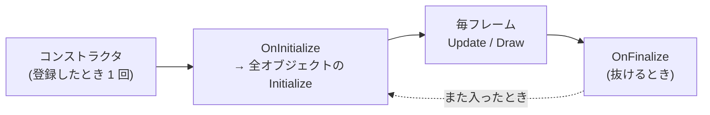

# シーン

シーンは、タイトル画面・ゲーム画面のような「画面のまとまり」です。シーンごとに、置いてあるオブジェクト・カメラ・当たり判定が分かれています。

## シーンを作る

`FS::BaseScene` を継承し、必要な関数だけを上書きします。作り方の流れは [チュートリアル 1](../tutorial/01-scene.md) と同じです。

```cpp
class TitleScene : public FS::BaseScene
{
public:
    TitleScene(FS::Engine* engine) : BaseScene(engine, SceneName::Title)
    {
        // シーンに置くものを作る (1 回だけ)
        menu_ = objectManager_.Create<TitleMenu>(engine_);
    }

protected:
    void OnInitialize() override {}   // シーンに入るたびに 1 回
    void OnUpdate() override {}       // 毎フレーム
    void OnDraw() override {}         // 毎フレーム
    void OnDebugGui() override {}     // 毎フレーム (エディター画面のときだけ)
    void OnFinalize() override {}     // シーンを抜けるときに 1 回

private:
    TitleMenu* menu_ = nullptr;
};
```

作ったシーンは `Game/Game.cpp` で登録します。シーンの名前は `Game/Global/GameDefine.h` の `SceneName` にまとめます。

```cpp
// Game のコンストラクタで
GetSceneManager().RegisterScene(std::make_unique<TitleScene>(GetEngine()));
GetSceneManager().SetInitialScene(SceneName::Title);   // 起動したときのシーン
```

## シーンを切り替える

シーンの中からは `sceneManager_` を使います。

```cpp
void TitleScene::OnUpdate()
{
    if (GameInput::IsTriggered(GameAction::Confirm))
    {
        sceneManager_->RequestSceneChange(SceneName::Play);
    }
}
```

すぐには切り替わらず、フェードアウト → 切り替え → フェードインの順に進みます。フェードの長さはエディター画面の「フェード設定」ウィンドウで調整できます。

## ゲームを終える

「ゲームを終了」のメニューなどからは、`engine_->RequestQuit()` を呼びます。そのフレームの処理を最後まで終えてから、ゲームが終了します。

## シーンが持っているもの

派生したシーンから、次のメンバーをそのまま使えます。

| メンバー | 使い道 |
| :--- | :--- |
| `engine_` | エンジン。モデルなどを作るときに渡す |
| `objectManager_` | シーンに置く GameObject の作成・検索 ([GameObject](gameobject.md)) |
| `camera_` | シーンのカメラ。画面はこのカメラから見たものになる |
| `cameraManager_` | カメラを動かす処理 (追従カメラなど) の切り替えと、画面の揺れ ([カメラ](camera.md)) |
| `binder_` | シーン名で保存する PropertyBinder。カメラ・ライト・ポストエフェクトの設定もここに保存される |
| `sceneManager_` | シーンの切り替え |

## 呼ばれる順番



毎フレームの中身は次の順です。

1. `OnUpdate()` → 全オブジェクトの `Update()` → 当たり判定 → カメラの更新
2. 全オブジェクトの `Draw()` → `OnDraw()`

## つまずきやすい点

- **シーンのインスタンスは使い回される。** 登録したときに 1 回だけ作られ、同じシーンに戻るとコンストラクタではなく `OnInitialize()` からやり直す。入るたびにリセットしたい値は `OnInitialize()` やオブジェクトの `Initialize()` で決める
- **シーンを切り替えると、パーティクルのエミッターはすべて消える。** エミッターは `Initialize()` で作る ([エフェクトとライト](effects.md))
- **一時停止中はシーンの更新が止まる。** `TimeManager::GetInstance()->Pause()` の間は `Update` が呼ばれないが、`Draw` は続く。メニューを開いている間だけ止めたいときは、`SetTimeScale(0.0f)` で時間を止める方が扱いやすい (`PlayScene` のポーズメニューがこの方法)
