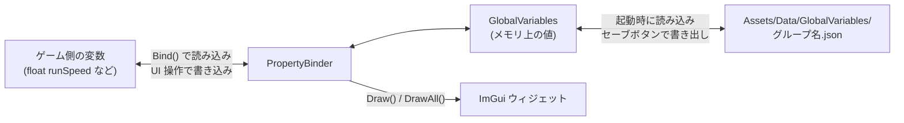

# FromSoheWare Engine プロパティバインダー ガイド

本ドキュメントでは、ゲームを実行しながらパラメータを調整・保存するための `FS::PropertyBinder` の使い方を解説します。
`PropertyBinder` に変数を登録 (バインド) すると、次の 3 つがまとめて行われます。

- **読み込み** : 保存済みの値 (JSON) があれば、その値を変数に書き込む
- **UI 化** : ImGui のスライダーやカラーピッカーを自動で作る
- **保存** : UI で変更した値を JSON ファイルに書き出せるようにする

---

## 目次
- [1. 仕組み](#1-仕組み)
- [2. 基本的な使い方](#2-基本的な使い方)
- [3. バインド関数の一覧](#3-バインド関数の一覧)
- [4. オブジェクト単位のバインド](#4-オブジェクト単位のバインド)
- [5. 保存と読み込み](#5-保存と読み込み)
- [6. シーンごとのカメラ・ライト・ポストエフェクト設定](#6-シーンごとのカメラライトポストエフェクト設定)
- [7. 注意点](#7-注意点)

---

## 1. 仕組み

`PropertyBinder` は、エンジンのシングルトン `FS::GlobalVariables` の上に作られた便利クラスです。



- エンジン起動時 (`Engine::Initialize()`) に、`Assets/Data/GlobalVariables/` にある全 JSON ファイルが `GlobalVariables` に読み込まれます。
- `Bind()` を呼ぶと、その時点で保存済みの値が変数へコピーされます。保存済みの値がなければ、引数で渡した **既定値** が登録されて変数にコピーされます。
- ImGui で値を動かすと、変数と `GlobalVariables` (メモリ上) の両方が即座に更新されます。ファイルに書き出されるのはセーブボタンを押したときだけです。

---

## 2. 基本的な使い方

### Step 1: PropertyBinder を生成する

コンストラクタの第 1 引数に `Engine*`、第 2 引数以降に **グループ名** を渡します。先頭のグループ名がそのまま保存ファイル名になります。

```cpp
// メンバー
std::unique_ptr<FS::PropertyBinder> binder_;

// コンストラクタ
binder_ = std::make_unique<FS::PropertyBinder>(engine_, "Player");
// → Assets/Data/GlobalVariables/Player.json に保存される
```

グループ名は複数並べて階層にできます。

```cpp
// Stage1.json の中の "Boss" グループに保存される
binder_ = std::make_unique<FS::PropertyBinder>(engine_, "Stage1", "Boss");
```

### Step 2: 変数をバインドする

`Initialize()` など、オブジェクトの準備が整ったタイミングで呼びます。

```cpp
void Player::Initialize()
{
    //            キー          変数のアドレス       既定値  ドラッグ速度  最小値  最大値
    binder_->Bind("RunSpeed",   &config.runSpeed,    10.0f,  0.01f,        0.0f,   50.0f);
    binder_->Bind("JumpPower",  &config.jumpPower,   5.0f);
    binder_->Bind("ColliderSize", &colliderSize_, { 0.5f, 1.0f, 0.5f });
    binder_->BindColor("AuraColor", &auraColor_, { 1.0f, 1.0f, 1.0f, 1.0f });
}
```

### Step 3: ImGui に表示する

`DebugDraw()` の中で、表示したい項目を `Draw()` で描画します。第 2 引数は画面に出す表示名で、省略するとキーがそのまま表示されます。

```cpp
void Player::DebugDraw()
{
#ifdef ENABLE_IMGUI
    if (ImGui::Begin("プレイヤー"))
    {
        binder_->Draw("RunSpeed", "走り速度");
        binder_->Draw("JumpPower", "ジャンプ力");
        binder_->Draw("ColliderSize", "当たり判定サイズ");
        binder_->Draw("AuraColor", "オーラの色");
    }
    ImGui::End();
#endif
}
```

登録したものを登録順にすべて表示するなら `DrawAll()` が使えます。

```cpp
binder_->DrawAll();
```

`Draw()` は値が変更されたフレームに `true` を返すので、変更時だけ処理したい場合にも使えます。

```cpp
if (binder_->Draw("Radius", "半径"))
{
    RebuildMesh(); // 値が変わったときだけ作り直す
}
```

---

## 3. バインド関数の一覧

### 3-1. 基本型

| 関数 | 対象の型 | ImGui ウィジェット |
| :--- | :--- | :--- |
| `Bind(key, int32_t*, default, speed, min, max)` | `int32_t` | DragInt |
| `Bind(key, uint32_t*, default, speed, min, max)` | `uint32_t` | DragInt |
| `Bind(key, float*, default, speed, min, max)` | `float` | DragFloat |
| `Bind(key, bool*, default)` | `bool` | Checkbox |
| `Bind(key, Vector2*, default, speed, min, max)` | `Vector2` | DragFloat2 |
| `Bind(key, Vector3*, default, speed, min, max)` | `Vector3` | DragFloat3 |
| `Bind(key, Vector4*, default, speed, min, max)` | `Vector4` | DragFloat4 |

`speed` / `min` / `max` は省略できます。`min` と `max` がどちらも 0 (既定) の場合は範囲制限なしになります。
`float` と `Vector3` には、値が変わったときに呼ばれるコールバックを最後の引数に渡せるオーバーロードもあります。

```cpp
binder_->Bind("FOV", &fovY_, 0.45f, 0.01f, 0.01f, 3.14f,
    [this]() { UpdateProjectionMatrix(); });
```

### 3-2. 特殊な UI

| 関数 | 内容 |
| :--- | :--- |
| `BindColor(key, Vector3* / Vector4* / uint32_t*, default)` | カラーピッカーで色を編集する |
| `BindBool(key, int32_t* / uint32_t*, default)` | 整数 (0/1) をチェックボックスで編集する。シェーダー定数のフラグなどに使う |
| `BindCombo(key, int32_t*, default, items)` | ドロップダウンで選択する。`items` は `"Low\0Middle\0High\0"` のように `\0` 区切りの文字列 |
| `BindRotation(key, Vector3* euler, Quaternion* quat, speed, onChange)` | オイラー角で編集し、クォータニオンへ自動変換する |
| `BindModelName(key, std::string*, default, onChange)` | 読み込み済みモデルの中から名前を選ぶ |
| `BindTexture(...)` | 読み込み済みテクスチャの中から選ぶ。`TextureType` で候補を絞り込める |

---

## 4. オブジェクト単位のバインド

`Model`・`AnimationModel`・`Sprite`・`Terrain` は、まとめてバインドする関数が用意されています。位置・回転・拡縮、マテリアル、テクスチャなどの項目が一度に登録されます。

| バインド | 表示 | 登録される主な項目 |
| :--- | :--- | :--- |
| `BindModel(name, Model*)` | `DrawModel(name, label)` | 位置・回転・拡縮、マテリアル |
| `BindAnimationModel(name, AnimationModel*)` | `DrawAnimationModel(name, label)` | 位置・回転・拡縮、マテリアル |
| `BindSprite(name, Sprite*)` | `DrawSprite(name, label)` | 位置・サイズ・回転・基準点・色・テクスチャ・表示/非表示・重なり順 |
| `BindTerrain(name, Terrain*)` | `DrawTerrain(name, label)` | 地形のパラメータ |

```cpp
// GameUI.cpp の例
void GameUI::Initialize()
{
    binder_->BindSprite("SpriteMove", spriteMove_.get());
}

void GameUI::DebugDraw()
{
#if ENABLE_IMGUI
    ImGui::Begin("ゲームUI調整");
    binder_->DrawSprite("SpriteMove", "Moveインスペクター");
    ImGui::End();
#endif
}
```

---

## 5. 保存と読み込み

### 5-1. 保存

ImGui の **「グローバル変数」** ウィンドウから保存します。

- 各グループのツリーを開いて **「セーブ」** を押すと、そのグループのファイルだけが保存されます。
- 上部の **「全てのグローバル変数を保存」** を押すと、全グループが保存されます。

保存先は `project/Assets/Data/GlobalVariables/<先頭のグループ名>.json` です。JSON は次のような形式で、手で編集することもできます。

```json
{
    "Player": {
        "Gravity": 74.04000091552734,
        "ColliderSize": [ 1.0, 3.96, 1.0 ]
    }
}
```

:::{important}
ImGui で値を変えただけではファイルは更新されません。調整が終わったら必ずセーブボタンを押してください。保存しないままゲームを終了すると、次回の起動時には前回保存した値に戻ります。
:::

### 5-2. 読み込み

ファイルの読み込みはエンジン起動時に 1 回だけ自動で行われ、`Bind()` を呼んだ時点で変数に反映されます。
読み込み処理は ImGui の有無に関係なく動くため、ImGui を外したビルドでも、開発中に調整・保存した値がそのまま使われます。

### 5-3. 登録の解除

```cpp
binder_->Clear();      // UI の登録だけを解除 (保存データは残る)
binder_->Clear(true);  // 保存データも含めて消去
```

---

## 6. シーンごとのカメラ・ライト・ポストエフェクト設定

`BaseScene` は、シーン名をグループ名にした `PropertyBinder` (`binder_`) を自動で持っています。シーンの `Initialize()` 時に、次の設定がこの `binder_` に自動でバインドされます。

- シーンカメラ (`Camera/Position`、`Camera/FOV` など)
- ポストエフェクト (`PostEffect/Bloom/...`、`PostEffect/Vignette/...` など)
- ライト (`Light/Directional/0/Color` など)

そのため、カメラの初期位置・ライト・ポストエフェクトは **シーンごとに** 別々の値を持ち、`PlayScene.json` や `TitleScene.json` に保存されます。ImGui ではシーン名のウィンドウに表示されます。

シーン固有のパラメータも、この `binder_` にバインドすれば同じファイルに保存されます。

```cpp
void PlayScene::OnInitialize()
{
    binder_->Bind("TimeLimit", &timeLimit_, 180.0f, 1.0f, 0.0f, 999.0f);
}
```

---

## 7. 注意点

- **引数の順番** : `Bind(key, ptr, 既定値, ドラッグ速度, ...)` の 3 番目の引数は **既定値** です。ドラッグ速度だけを指定するつもりで `Bind("Speed", &speed_, 0.01f)` と書くと、既定値が 0.01 になり、ドラッグ速度は既定の 0.01 のままになります。保存済みの値がある間は既定値は使われないため気づきにくいので注意してください。
- **`Bind()` は変数を上書きします** : `Bind()` の時点で、保存済みの値 (なければ既定値) が変数に書き込まれます。コンストラクタで設定した初期値は上書きされるので、初期値は既定値として渡してください。
- **キーはグループ内で一意にする** : 同じキーで再度バインドすると、保存済みの値が読み込まれ、UI は後からバインドした変数を指すようになります。シーンに入り直したときに `Initialize()` で再バインドしても問題ないのはこのためですが、別々の変数に同じキーを付けると 1 つの値を取り合うことになります。
- **変数の寿命** : `PropertyBinder` は変数のアドレスを保持します。バインドした変数より `PropertyBinder` が長生きしないように、同じオブジェクトのメンバーとして持たせてください。
- **表示名とキー** : ImGui の内部 ID にはキーが使われるため (`表示名###キー`)、表示名は日本語でも重複していても問題ありません。
