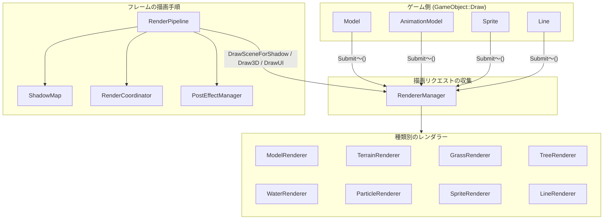
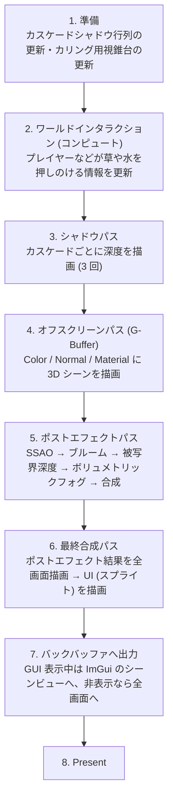

# 描画パイプライン

本ドキュメントでは、FromSoheWare エンジンが 1 フレームをどのような手順で描画しているかと、描画に関わる主要クラスの役割分担を解説します。
ゲームを作るだけなら [描画ガイド](drawingGuide.md) の内容で十分です。ここでは、エンジンの描画処理を改造・拡張したいときに必要な内部構造を扱います。

---

## 目次
- [1. 描画に関わるクラスの役割](#1-描画に関わるクラスの役割)
- [2. 1 フレームの描画手順](#2-1-フレームの描画手順)
- [3. ポストエフェクト](#3-ポストエフェクト)
- [4. ディスクリプタとリソースの管理](#4-ディスクリプタとリソースの管理)

---

## 1. 描画に関わるクラスの役割

描画処理は「何を描くか」を表すクラスと、「どう描くか」を担当するクラスに分かれています。

| クラス | 役割 |
| :--- | :--- |
| `Model` / `AnimationModel` / `Sprite` / `Line` | 描画したいものを表す。`Draw()` で `RendererManager` に描画リクエストを登録する |
| `RendererManager` | 描画リクエストを受け取り、種類別のレンダラーに振り分ける。描画グループ (`RenderGroup`) ごとの描画順も管理する |
| `ModelRenderer`、`TerrainRenderer`、`GrassRenderer` など | 種類ごとにバッチ化・インスタンシングして、実際に描画コマンドを積む |
| `RenderPipeline` | 1 フレームの描画手順 (どのパスをどの順に実行するか) を管理する |
| `ShadowMap` | カスケードシャドウマップ (3 分割) のリソースと描画パスの開始・終了 |
| `RenderCoordinator` | オフスクリーン (G-Buffer) とバックバッファのレンダーターゲット切り替え、リソースバリア、Present |
| `PostEffectManager` | ポストエフェクトパスの実行順と、最終合成 |
| `PSOManager` / `RootSignatureManager` / `ShaderManager` | PSO・ルートシグネチャ・シェーダーの生成とキャッシュ |
| `LightManager` | 平行光源・点光源・スポットライトのデータと、カスケードシャドウの行列計算 |

---

## 2. 1 フレームの描画手順

`Engine::EndFrame()` から呼ばれる `RenderPipeline::Render()` が、次の順に描画を実行します。

### 2-1. ワールドインタラクション

地形のハイトマップがあるシーンでは、`WorldInteractionPass` (コンピュートシェーダー) がプレイヤーなどの位置から「押しのけ」テクスチャを更新します。草・葉・水の描画はこのテクスチャを参照して揺れや波紋を表現します。地形がないシーンではスキップされます。

### 2-2. シャドウパス

`LightManager::UpdateCascadedShadows()` でカメラの視錐台を 3 つに分割し、それぞれに平行光源から見た行列を計算します。その後、カスケードごとに `RendererManager::DrawSceneForShadow()` で影を落とすオブジェクトの深度を描画します。

### 2-3. オフスクリーンパス (G-Buffer)

`RendererManager::Draw3D()` が、次の順で 3D シーンを描画します。

1. 地形 (Early-Z のため最初に描画)
2. 葉、木
3. 不透明モデル (`RenderGroup::Opaque`)
4. 草
5. グリッド (`RenderGroup::Grid`)
6. スカイボックス、デバッグライン、スカイドーム
7. 水
8. 半透明モデル (`RenderGroup::Transparent`)
9. パーティクル、トレイル、雷

描画先は Color・Normal・Material の 3 枚のレンダーターゲットと深度バッファで、後段のポストエフェクトが法線や材質の情報を参照します。

---

## 3. ポストエフェクト

`PostEffectManager::ExecutePostEffects()` が次の順にパスを実行します。各パスは `IPostEffect` を継承しています。

| 順番 | パス | 内容 |
| :--- | :--- | :--- |
| 1 | `SSAOPass` → `BilateralBlurPass` (横 → 縦) | スクリーンスペース環境遮蔽と、そのノイズ除去 |
| 2 | `BrightExtractPass` → `BloomPass` | 明るい部分の抽出とブルーム |
| 3 | `DoFPass` | 被写界深度 |
| 4 | `VolumetricFogPass` → `VolumetricFogBilateralPass` | Froxel ベースのボリュメトリックフォグと、そのノイズ除去 |
| 5 | `FinalCompositePass` | 上記の結果とシーンカラーを合成 |

さらに、最終合成パス (2 節の手順 6) で全画面描画するときに、`PostEffects.PS.hlsl` が色調補正 (Color Tint)、ビネット、色収差、ピクセル化、放射ブラー、スクリーンノイズ、LUT によるカラーグレーディングを適用します。これらの有効/無効やパラメータは、シーンごとに `PropertyBinder` で調整・保存できます ([プロパティバインダー ガイド 6 節](propertyBinderGuide.md#6-シーンごとのカメラライトポストエフェクト設定))。

### 3-1. ポストエフェクトを追加するには

1. `IPostEffect` を継承したクラスを作り、`InitializeBase()` で出力テクスチャを作成して `Execute()` を実装する
2. PSO の定義 JSON (`Assets/Data/PSODefinitions/`) とシェーダー (`Assets/Shaders/PostProcess/`) を追加する
3. `PostEffectManager` にメンバーとして追加し、`Initialize()` で初期化、`ExecutePostEffects()` で実行順の適切な位置から呼ぶ
4. 結果を合成に使う場合は、`FinalCompositePass::SetupInputViews()` に入力を追加する

`Execute()` に渡される `PostEffectContext` から、シーンカラー・深度・法線・材質の SRV インデックスを取得できます。

---

## 4. ディスクリプタとリソースの管理

| クラス | 内容 |
| :--- | :--- |
| `SRVManager` | シェーダーから見えるディスクリプタヒープ (SRV/UAV、最大 1000 個) を 1 つ持ち、インデックスで割り当てる。テクスチャは「SRV インデックス (ハンドル)」として扱われる |
| `RTVManager` | スワップチェーンのバックバッファ用 RTV |
| `OffscreenRTVManager` | G-Buffer やポストエフェクト用のオフスクリーン RTV (最大 32 個) |
| `DSVManager` | 深度バッファ (最大 8 個) と、その深度を読むための SRV |
| `TextureLoader` | テクスチャの読み込み、DDS 変換、アップロード用中間リソースの寿命管理 |
| `CommandManager` | コマンドキュー・コマンドリスト・フェンス、GPU の完了待ち |

テクスチャのアップロードに使った中間リソースは、`Engine::EndFrame()` で GPU の処理完了 (フェンス値) を確認してから解放されます。
