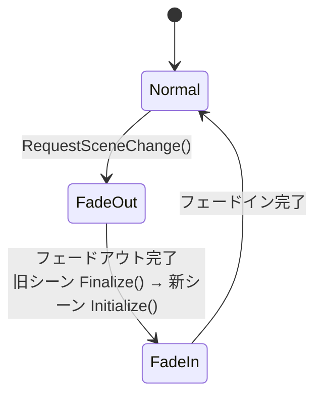

# FromSoheWare Engine 開発・シーン構築ガイド

本ドキュメントでは、FromSoheWare エンジンを使用して新しいゲームシーンを作成し、オブジェクトのライフサイクルを運用し、実際にゲームに組み込むまでの手順について解説します。

---

## 1. シーンアーキテクチャとライフサイクル

本エンジンでは `FS::BaseScene` を基底クラスとした **Template Method パターン** を採用しています。
更新・描画・衝突判定・ImGui デバッグ UI 描画といった「毎フレーム必ず行う共通処理」はエンジン側で自動実行されるため、ユーザーは個別のシーンクラス（例: `PlayScene`）で必要な関数のみをオーバーライドするだけで済みます。

### 自動管理される実行フロー
1. **`Initialize()`**: 共通初期化 ➔ `OnInitialize()` ➔ プロパティ自動バインド ➔ オブジェクト初期化
2. **`Update()`**: `OnUpdate()` ➔ オブジェクト更新 ➔ 衝突判定 (`CheckAllCollisions()`) ➔ カメラ更新
3. **`Draw()`**: オブジェクト描画 ➔ カメラ/ポストエフェクト描画 ➔ `OnDraw()`
4. **`DebugDraw()`**: デバッグ描画 ➔ ImGui パラメータ自動描画 ➔ `OnDebugDraw()`
5. **`Finalize()`**: 衝突マネージャー等のリセット ➔ 終了処理 ➔ `OnFinalize()`

---

## 2. シーンの作成手順

新しいシーンを作成するには、`FS::BaseScene` を継承したクラスを定義します。

### Step 1: ヘッダーファイルの定義 (`PlayScene.h`)
必要な関数をオーバーライドし、シーン内で管理したいオブジェクトのポインタを宣言します。

```cpp
#pragma once
#include "BaseScene.h"

class PlayScene : public FS::BaseScene 
{
public:
    PlayScene(FS::Engine* engine);

protected:
    // 必要な関数のみをオーバーライドして実装
    void OnInitialize() override;
    void OnUpdate() override;
    void OnDraw() override;
    void OnDebugDraw() override;
    void OnFinalize() override;

private:
    std::unique_ptr<FollowCamera> followCamera_;
};
```

### Step 2: シーンの実装 (`PlayScene.cpp`)
コンストラクタ内で `objectManager_.Create<T>()` を用いてオブジェクトを生成・登録します。**ここに登録するだけで、以後のライフサイクル（更新・描画・破棄）はエンジンが完全に自動管理します。**

```cpp
#include "PlayScene.h"

using namespace FS;

// BaseScene のコンストラクタにエンジン情報とシーン名を渡す
PlayScene::PlayScene(Engine* engine)
    : BaseScene(engine, "PlayScene")
{
    // 1. プレイヤーとカメラの生成＆登録
    auto player = objectManager_.Create<Player>(engine_, camera_.get());
    followCamera_ = std::make_unique<FollowCamera>(engine_, &player->GetTransform());

    // 2. 地形・環境オブジェクトの生成と依存関係のセット
    auto ground = objectManager_.Create<Ground>(engine_);
    auto grassField = objectManager_.Create<GrassField>(engine_);
    grassField->SetTerrain(ground->GetTerrain());

    // 3. 各種マネージャーの自動生成・登録
    objectManager_.Create<WeatherEffectManager>(engine_, camera_.get(), player, ground->GetTerrain());
    objectManager_.Create<EnemyManager>(engine_, "GameEnemy");
    objectManager_.Create<GameUI>(engine_);
}

void PlayScene::OnInitialize() 
{
    // シーン開始時の固有処理
    followCamera_->Initialize();
    cameraManager_->ChangeController(followCamera_.get());
}

void PlayScene::OnUpdate()
{
    // シーン固有ロジックを記述
}

void PlayScene::OnDraw()
{
    // シーン固有の追加描画があれば記述
}

void PlayScene::OnDebugDraw()
{
    // ImGui を使用したシーン固有のデバッグ情報表示を記述
}

void PlayScene::OnFinalize()
{
    // シーン終了時のクリーンアップ処理
}
```

---

## 3. シーンの登録と切り替え (Gameクラスへの組み込み)

作成したシーンを実際にゲーム内で動かすには、`Game.cpp`（またはシーン管理クラス）で `SceneManager` に登録する必要があります。

### 3-1. シーンの登録と初期シーンの設定
`Game::Game()` の初期化処理内で、作成したシーンを `RegisterScene` で登録し、`SetInitialScene` で起動時のシーンとして設定します。

```cpp
// Game.cpp のコンストラクタ
Game::Game() 
    : engine_(std::make_unique<Engine>())
{
    // ...エンジンの初期化処理...

    // シーンマネージャーの初期化
    sceneManager_.Initialize(engine_.get());

    // 作成したシーンをIDと紐づけて登録
    sceneManager_.RegisterScene(SceneID::Title, std::make_unique<TitleScene>(engine_.get()));
    sceneManager_.RegisterScene(SceneID::Play, std::make_unique<PlayScene>(engine_.get()));
    
    // 起動時に最初に開くシーンを設定
    sceneManager_.SetInitialScene(SceneID::Play);
}
```

### 3-2. 他のシーンへの遷移
ゲーム中（タイトル画面からプレイ画面へ移行する際など）にシーンを切り替えるには、`SceneManager` の `RequestSceneChange` を呼び出します。

```cpp
// 任意の場所（ボタンが押された時や、クリア時など）で呼び出す
sceneManager_.RequestSceneChange(SceneID::Play);
```

### 3-3. デバッグUI からのシーン切り替え
開発中は、ImGui を使用してエディタ画面上からいつでもシーンを切り替えられるようにしています。
`Game::DebugDraw()` 内に以下のように実装することで、シーン選択ウィンドウを表示できます。

```cpp
void Game::DebugDraw()
{
#ifdef ENABLE_IMGUI
    // デバッグ用のシーン切り替えウィンドウ
    if (ImGui::Begin("シーンの選択"))
    {
        if (ImGui::Button("タイトルシーン"))
        {
            sceneManager_.RequestSceneChange(SceneID::Title);
        }
        if (ImGui::Button("プレイシーン"))
        {
            sceneManager_.RequestSceneChange(SceneID::Play);
        }
        if (ImGui::Button("テストシーン"))
        {
            sceneManager_.RequestSceneChange(SceneID::Test);
        }
    }
    ImGui::End();
#endif
}
```
シーンの中から遷移する場合は、`BaseScene` が持っている `sceneManager_` (ポインタ) を使います。

```cpp
void TitleScene::OnUpdate()
{
    if (FS::Input::GetInstance().IsKeyTriggered(DIK_SPACE))
    {
        sceneManager_->RequestSceneChange(FS::SceneID::Play);
    }
}
```

---

## 4. 補足

### 4-1. 新しいシーン ID を追加する
シーン ID は `Engine/Framework/SceneManager.h` の `FS::SceneID` 列挙型で定義されています。新しいシーンを作ったら、ここに ID を追加してから `RegisterScene()` で登録してください。

```cpp
enum class SceneID
{
    Title,
    Play,
    Test,
    Result, // 追加
};
```

### 4-2. シーン遷移の流れ
`RequestSceneChange()` を呼ぶと、すぐには切り替わらず次の順に進みます。フェードの長さは `Fade` の設定 (`Fade.json`) で調整できます。



- フェードアウト中も現在のシーンの `Update()` と `Draw()` は続きます。
- シーンが切り替わるとき、`ParticleSystem` のパーティクルはすべて消去されます。
- シーンのインスタンスは `RegisterScene()` 時に一度だけ生成され、使い回されます。同じシーンに戻ったときは、コンストラクタではなく `Initialize()` (→ `OnInitialize()`) からやり直されます。

### 4-3. BaseScene が用意しているメンバー

派生シーンからは、次のメンバーをそのまま使えます。

| メンバー | 内容 |
| :--- | :--- |
| `engine_` | エンジンへのポインタ |
| `objectManager_` | シーン内の `GameObject` を管理する `GameObjectManager` |
| `camera_` | シーンのカメラ。描画にはこのカメラの行列が使われる |
| `cameraManager_` | カメラコントローラー (`FollowCamera` など) の切り替え。`ChangeController()` で変更 |
| `collisionManager_` | シーン内の衝突判定 (`Collider::RegisterToManager()` の登録先) |
| `binder_` | シーン名をグループ名にした `PropertyBinder` ([プロパティバインダー ガイド 6 節](propertyBinderGuide.md#6-シーンごとのカメラライトポストエフェクト設定)) |
| `sceneManager_` | シーン遷移のリクエストに使う `SceneManager` |
| `sceneName_` | シーン名 |

`DebugDraw()` (と `OnDebugDraw()`) は、ImGui の GUI が表示されているときだけ呼ばれます。
