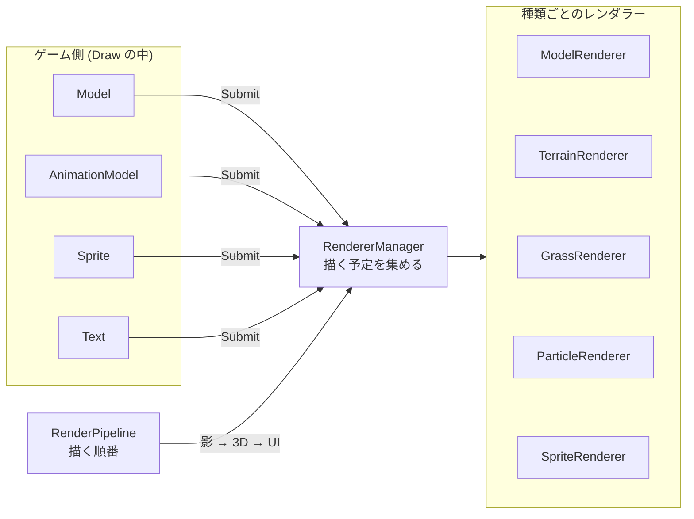
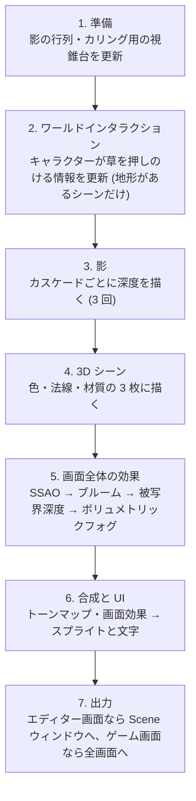

# 描画パイプライン

エンジンが 1 フレームをどの手順で描いているかと、描画に関わるクラスの役割です。
ゲームを作るだけなら [3D モデルとアニメーション](../guides/model.md) と [UI](../guides/ui.md) で十分で、ここは描画を改造・拡張するときに読む内容です。

## 「何を描くか」と「どう描くか」

| クラス | 役割 |
| :--- | :--- |
| `Model` / `AnimationModel` / `Sprite` / `Text` など | 描きたいもの。`Draw()` で `RendererManager` に描く予定を登録する |
| `RendererManager` | 描く予定を種類ごとのレンダラーに振り分ける。描画グループ (`RenderGroup`) ごとの順番も管理する |
| `ModelRenderer`・`TerrainRenderer`・`GrassRenderer` など | 種類ごとにまとめて (インスタンシングして) 描画コマンドを積む |
| `RenderPipeline` | 1 フレームの手順 (どのパスをどの順で行うか) |
| `PostEffectManager` | 画面全体の効果の順番と、最後の合成 |
| `LightManager` | 太陽・点光源・スポットライトのデータと、影の行列 |
| `PSOManager` / `RootSignatureManager` / `ShaderManager` | 描画設定・シェーダーの作成とキャッシュ |

## 1 フレームの描画手順

`Engine::EndFrame()` から呼ばれる `RenderPipeline::Render()` が、次の順に描きます。

### 3D シーンを描く順番

`RendererManager::Draw3D()` が次の順に描きます。

1. 地形 (手前のものから描いて、後ろの無駄な描画を減らすため最初)
2. 葉・木
3. 不透明なモデル (`RenderGroup::Opaque`)
4. 草
5. グリッド・スカイボックス・デバッグ線・空
6. 半透明なモデル (`RenderGroup::Transparent`)
7. パーティクル・トレイル・雷

### 画面全体の効果

`PostEffectManager::ExecutePostEffects()` が次の順に行い、最後に `FinalCompositePass` で合成します。各パスは `IPostEffect` を継承しています。

| 順番 | パス | 内容 |
| :--- | :--- | :--- |
| 1 | `SSAOPass` → `BilateralBlurPass` (横 → 縦) | 物の隙間の暗がりと、そのノイズ除去 |
| 2 | `BrightExtractPass` → `BloomPass` | 明るい部分のにじみ |
| 3 | `DoFPass` | ピントの外れたぼけ |
| 4 | `VolumetricFogPass` → `VolumetricFogBilateralPass` | 光の筋が見える霧と、そのノイズ除去 |

合成のあとの全画面描画で、ビネット・色収差・ピクセル化・放射ブラーなどを掛けます (`Engine/Shaders/PostProcess/PostEffects.PS.hlsl`)。
どれもシーン名のウィンドウの「ポストエフェクト設定」で調整し、シーンごとに保存できます。

## 画面全体の効果を足す

1. `IPostEffect` を継承したクラスを作り、`InitializeBase()` で出力先を作って `Execute()` を書く
2. 描画設定の JSON (`Engine/Assets/Data/PSODefinitions/`) とシェーダー (`Engine/Shaders/PostProcess/`) を足す
3. `PostEffectManager` のメンバーに足し、`Initialize()` で初期化、`ExecutePostEffects()` の適切な位置で実行する
4. 結果を合成に使うなら、`FinalCompositePass` の入力にも足す

`Execute()` に渡される `PostEffectContext` から、シーンの色・深度・法線・材質を読めます。

## シェーダーのキャッシュ

- Development は、起動時にシェーダーを最適化してコンパイルし、結果を `Cache/Shaders/` に保存する。元のファイルより新しい結果があればそれを使う
- Debug は最適化せずにコンパイルし、`Cache/ShadersDebug/` に保存する。シェーダーのデバッガーで 1 行ずつ追えるようにするため
- Release はコンパイルせず `Cache/Shaders/` の結果だけを使う。シェーダーを変えたら、Release の前に Development で一度起動する
- コンパイルの設定 (`ShaderManager.cpp` の `kCompileSettings`) を変えると、次の起動で古い結果を消してコンパイルし直す

## リソースの管理

| クラス | 内容 |
| :--- | :--- |
| `SRVManager` | シェーダーから読むテクスチャなどの登録先。テクスチャはここでの番号 (ハンドル) で扱う |
| `RTVManager` / `OffscreenRTVManager` / `DSVManager` | 描き込み先 (画面・中間テクスチャ・深度) |
| `TextureLoader` | テクスチャの読み込みと DDS への変換 |
| `CommandManager` | コマンドの送信と GPU の完了待ち |
