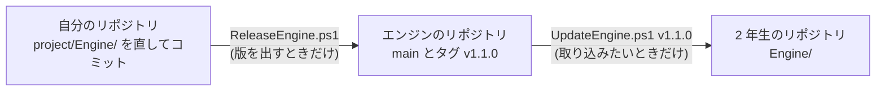

# エンジンの版を出す

エンジンの担当者が、`project/Engine/` の変更を 2 年生のリポジトリに届けるための手順です。ゲームを作る人は読まなくてかまいません。

## しくみ



- 普段は自分のリポジトリの `project/Engine/` を直してコミットするだけ。エンジンのリポジトリには何も届かない
- 版を出したときだけエンジンのリポジトリが更新される。2 年生は、取り込みたいときにタグを指定して取り込む

## 最初の 1 回だけ

1. GitHub で非公開のリポジトリを作り、2 年生を招待する
2. 自分のリポジトリに登録する

   ```powershell
   git remote add engine <エンジンのリポジトリの URL>
   ```

3. `project/Engine/UpdateEngine.ps1` の `$engineRepositoryUrl` にそのリポジトリの URL を書いてコミットする

## 版を出す

1. `project/Engine/CHANGELOG.md` の「未リリース」を、出す版の見出し (`## v1.1.0 (2026-12-01)` など) に書き換えてコミットする。ゲーム側で直す必要がある変更は「対応が必要」に書く
2. `project/` で実行する

   ```powershell
   .\ReleaseEngine.ps1 v1.1.0
   ```

3. 2 年生に、版の番号と CHANGELOG の内容を伝える

スクリプトは次を確かめてから出します。どれかに当てはまると何もせずに止まります。

- 版の番号が `v1.2.3` の形でない
- `project/Engine/` にコミットしていない変更がある
- CHANGELOG にその版の見出しがない
- 同じ番号の版をすでに出している

## 版の番号の付け方

| 変わる数字 | どんなとき | 例 |
| :--- | :--- | :--- |
| 1 つ目 | ゲームのコードを直さないとビルドが通らない変更 (関数名の変更・削除など) | `v1.4.2` → `v2.0.0` |
| 2 つ目 | 機能を足した。今のゲームはそのまま動く | `v1.4.2` → `v1.5.0` |
| 3 つ目 | 不具合を直しただけ | `v1.4.2` → `v1.4.3` |

## 気をつけること

- **エンジンから `Game/` のヘッダーを include しない。** 自分のリポジトリではビルドが通っても、2 年生のリポジトリでは通らない
- **出した版は消したり作り直したりしない。** 間違えたら、直して次の番号で出す
- 2 年生の提出や締め切りの前は、1 つ目の数字が変わる版を出さない
