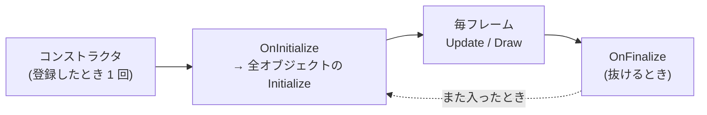

# シーン

シーンは、タイトル画面・ゲーム画面のような「画面のまとまり」です。シーンごとに、置いてあるオブジェクト・カメラ・当たり判定が分かれています。

## シーンを作る

`FS::BaseScene` を継承し、必要な関数だけを上書きします。作り方の流れは [チュートリアル 1](../tutorial/01-scene.md) と同じです。

例として、文字を出して、決定ボタンでゲームのシーンに進むタイトル画面を作ります。
シーンの名前 (`SceneName::Title` と `SceneName::Play`) は、先に `Game/Global/GameDefine.h` に足しておきます。

```cpp
// Game/Scene/TitleScene.h
#pragma once
#include "BaseScene.h"
#include "Text.h"

class TitleScene : public FS::BaseScene
{
public:
    TitleScene(FS::Engine* engine);

protected:
    void OnInitialize() override;   // シーンに入るたびに 1 回
    void OnUpdate() override;       // 毎フレーム
    void OnDraw() override;         // 毎フレーム
    void OnDebugGui() override;     // 毎フレーム (エディター画面のときだけ)
    void OnFinalize() override;     // シーンを抜けるときに 1 回

private:
    std::unique_ptr<FS::Text> guideText_;
};
```

```cpp
// Game/Scene/TitleScene.cpp
#include "pch.h"
#include "TitleScene.h"
#include "SceneManager.h"
#include "GameDefine.h"
#include "GameInput.h"
#include "Environment.h"

using namespace FS;

TitleScene::TitleScene(Engine* engine)
    : BaseScene(engine, SceneName::Title)
{
    // シーンに置くものと、シーンが持つものを作る (ゲームを通して 1 回)
    objectManager_.Create<Environment>(engine_);

    guideText_ = std::make_unique<Text>(engine_);
    guideText_->SetText("スペースキーで スタート");   // 漢字は Charset.txt に足したものだけ出る
    guideText_->SetAnchor(UIAnchor::BottomCenter);
    guideText_->SetPosition({ 0.0f, -80.0f });
}

void TitleScene::OnInitialize() {}

void TitleScene::OnUpdate()
{
    if (GameInput::IsTriggered(GameAction::Confirm))
    {
        sceneManager_->RequestSceneChange(SceneName::Play);
    }
}

void TitleScene::OnDraw()
{
    guideText_->Draw();
}

void TitleScene::OnDebugGui() {}
void TitleScene::OnFinalize() {}
```

使わない `On〜` 関数は、書かなくて構いません。

作ったシーンは `Game/Game.cpp` で登録します。

```cpp
// Game のコンストラクタで
GetSceneManager().RegisterScene(std::make_unique<TitleScene>(GetEngine()));
GetSceneManager().SetInitialScene(SceneName::Title);   // 起動したときのシーン
```

## シーンを切り替える

シーンの中からは、`sceneManager_->RequestSceneChange(シーンの名前)` を呼びます。
**使う `.cpp` で `#include "SceneManager.h"` が必要です。**

`BaseScene.h` は `SceneManager` を名前だけ知っている状態 (前方宣言) で持っていて、中身は読み込んでいません。ヘッダーどうしが読み込み合う形を避けるための一般的な書き方で、関数を呼ぶ `.cpp` の側で `#include` するのが正しい使い方です。

```cpp
#include "SceneManager.h"

sceneManager_->RequestSceneChange(SceneName::Play);
```

すぐには切り替わらず、フェードアウト → 切り替え → フェードインの順に進みます。フェードの長さはエディター画面の「フェード設定」ウィンドウで調整できます。

GameObject の中からシーンを切り替えたいときは、シーンが作るときに `SceneManager*` を渡しておくか、シーンの `OnUpdate()` で GameObject の状態を見て切り替えます。

## ゲームを終える

「ゲームを終了」のメニューなどからは、`engine_->RequestQuit()` を呼びます。そのフレームの処理を最後まで終えてから、ゲームが終了します。

## シーンが持っているもの

派生したシーンから、次のメンバーをそのまま使えます。

| メンバー | 使い道 |
| :--- | :--- |
| `engine_` | エンジン。モデルなどを作るときに渡す |
| `objectManager_` | シーンに置く GameObject の作成・検索 ([GameObject](gameobject.md)) |
| `camera_` | シーンのカメラ。画面はこのカメラから見たものになる |
| `cameraManager_` | カメラを動かす処理 (追従カメラなど) の切り替えと、画面の揺れ ([カメラ](camera.md))。使う `.cpp` で `#include "CameraManager.h"` |
| `binder_` | シーン名で保存する PropertyBinder。カメラ・ライト・ポストエフェクトの設定もここに保存される |
| `sceneManager_` | シーンの切り替え。使う `.cpp` で `#include "SceneManager.h"` |

## 呼ばれる順番



毎フレームの中身は次の順です。

1. `OnUpdate()` → 全オブジェクトの `Update()` → 当たり判定 → カメラの更新
2. 全オブジェクトの `Draw()` → `OnDraw()`

## つまずきやすい点

- **`sceneManager_->` でエラーになる。** 「不完全な型」のエラーなら、その `.cpp` で `#include "SceneManager.h"` していない
- **シーンのインスタンスは使い回される。** 登録したときに 1 回だけ作られ、同じシーンに戻るとコンストラクタではなく `OnInitialize()` からやり直す。入るたびにリセットしたい値は `OnInitialize()` やオブジェクトの `Initialize()` で決める
- **シーンを切り替えると、パーティクルのエミッターはすべて消える。** エミッターは `Initialize()` で作る ([エフェクトとライト](effects.md))
- **モデルが真っ黒に映る。** シーンに `Environment` を置いていない。太陽の光は `Environment` が決めている ([エフェクトとライト](effects.md#時間帯と天気))
- **一時停止中はシーンの更新が止まる。** `TimeManager::GetInstance()->Pause()` の間は `Update` が呼ばれないが、`Draw` は続く。メニューを開いている間だけゲームを止めたいときは、`SetTimeScale(0.0f)` で時間を止める方が扱いやすい
